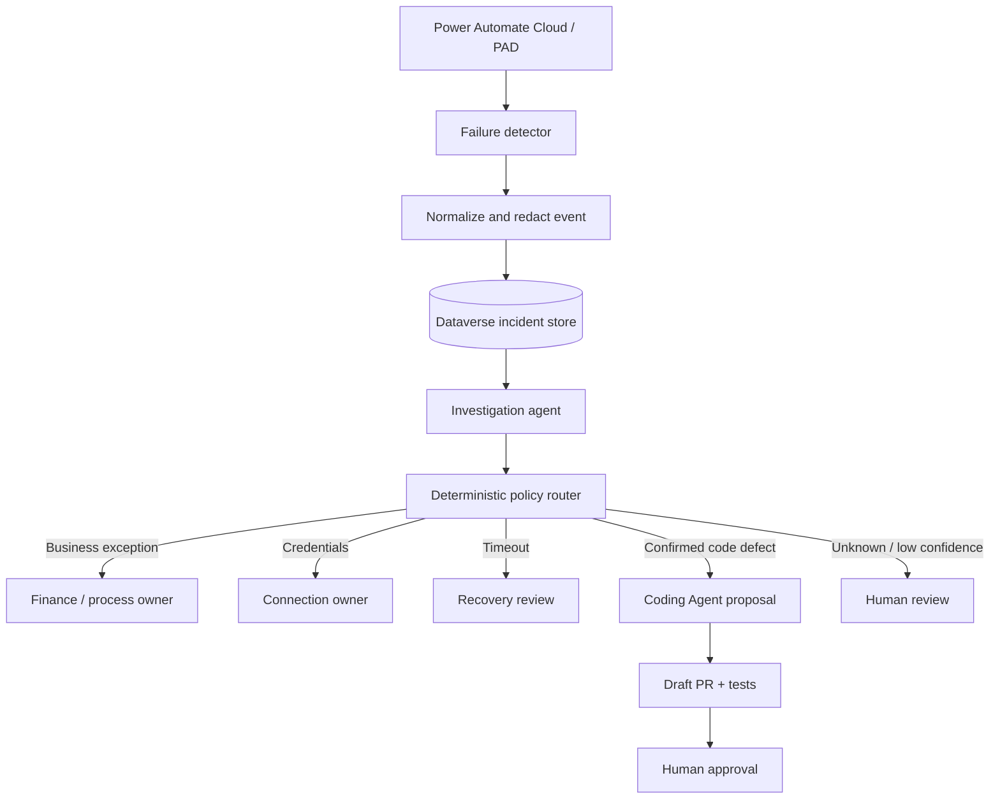

# SpectreWatch reference architecture

## Components
1. **Telemetry:** approved Power Automate run-history sources, PAD execution results, and dependency status.
2. **Collector:** normalize platform errors into `failure-event.v1`; deduplicate by environment + flow + run ID.
3. **Dataverse:** automation registry, incidents, failure events, investigations, remediation actions, and knowledge articles.
4. **Investigation:** retrieve sanitized evidence and verified knowledge matches; return classification, evidence, confidence, and recommended action.
5. **Policy router:** deterministic rules take precedence over model suggestions.
6. **Remediation:** notify, create ticket, or allowlisted idempotent recovery. Coding Agent proposes a branch/draft PR only.
7. **Experience:** Power Apps incident dashboard and Teams adaptive-card notifications.

## Design principles
Platform-neutral event schema, least privilege, data minimization, idempotency, bounded retries, auditability, and human approval for production-impacting changes.
